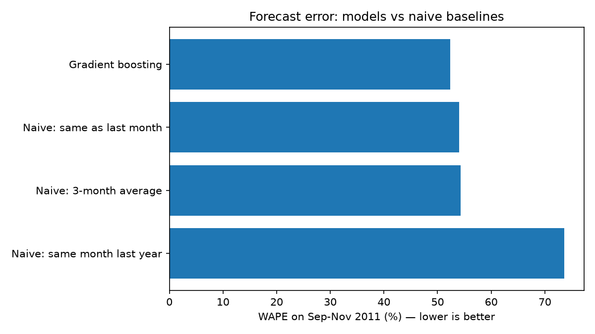

My coursework version of this project (SuperKart, in the UT Austin Post-Graduate Program in AI &
Machine Learning) predicted product sales with a gradient-boosting regressor in a notebook. It looked
great. When I rebuilt it as a real service on real retail data, the honest result was much more
modest, and much more useful to know.
[Try the forecaster](https://srikarbolleddu.com/projects/sales-forecast-prediction-system#demo) or
[read the code](https://github.com/srikarbolleddu/ml-sales-forecast).

## The data and the question

[Online Retail II](https://archive.ics.uci.edu/dataset/502/online+retail+ii) (CC BY 4.0) contains
about a million invoice lines from a UK online gift retailer, December 2009 to December 2011.

The question a buyer asks every month: **how many units of each product will we sell next month?**

## Step 1: a panel built only from the past

Raw invoice lines aren't a training set. I turned them into a **monthly panel**: one row per product
per month, holding only what was known at the end of that month, with next month's units as the
target.

- Cancellations, returns, zero-price lines and non-products (postage, fees) are removed.
- Inputs: units sold in each of the last three months, units in the same month last year, customers
  last month, typical price and its 3-month change, months on sale, and the month being forecast.
- **"Same month last year" is missing, not zero,** if the product wasn't on sale yet. My first
  version filled it with 0, which tells the model "on sale, sold nothing". That's a different and
  false statement.

```python
"units_same_month_last_year": units[lag12] if lag12 >= first_sale else np.nan,
```

The same functions build features for training and for live API requests, so the two can never
drift apart. That's the most important part of turning a notebook into a service.

## Step 2: compare against a naive forecast

The simplest forecast is "next month = last month". Here's how everything did on the three held-out
months (September to November 2011, 9,315 product-months):

| Forecaster | WAPE | Total bias |
|---|---|---|
| **Gradient boosting (Poisson loss)** | **52.4%** | **−4%** |
| Naive: same as last month | 54.0% | −15% |
| Naive: 3-month average | 54.3% | −26% |
| Naive: same month last year | 73.6% | +19% |

WAPE is total absolute error divided by total units sold. Lower is better.



The model wins, in every one of the three months. But by **3%**. Monthly demand for an individual
product here is lumpy, because wholesale customers place big orders irregularly, and last month's
sales already capture most of what's predictable.

Where the model really earns its keep is **bias**. Going into the Christmas ramp, "same as last
month" under-forecasts total demand by 15%: it can't know November is coming. The model, which knows
the forecast month and last year's sales, is only 4% low. For a buyer ordering stock, a forecast
that's right in total and a bit noisy per product beats one that's systematically short.

Two choices that helped:

- **Poisson loss.** Sales are counts, and Poisson loss beat squared error on validation
  (WAPE 0.533 vs 0.557). It models "how many" rather than chasing the occasional giant order.
- **Choosing everything on validation months** (July and August), then refitting on all data up to
  August before touching the test months once.

## Step 3: never split time series randomly

Most tutorials split rows at random, and for this data that's quietly wrong. A random split puts
November 2011 rows in training and September 2011 rows in test. The model gets to learn from the
future of the period it's tested on.

How much does that matter? I trained the same model on a random 80% of all rows, then scored it and
the honest model on **the same 1,891 rows**: test-month rows that neither had seen.

| Trained on | WAPE on the same rows |
|---|---|
| A random split (saw later months) | 48.0% |
| Earlier months only | 50.9% |

The random split makes the model look **6% better**, about **twice its real advantage over the
naive forecast**. Had I evaluated that way, I'd have reported a solid improvement. The honest split
says the improvement is real but small.

(I first compared the random-split score on its own random test rows against the time-split score on
the test months. Those are different rows, so the comparison meant nothing. It even pointed the
wrong way. Compare models on the same rows.)

## Step 4: from notebook to API

The notebook became a small service:

- **`app/features.py`:** the cleaning, the panel and the input definitions. The input definitions
  also generate the API's validation rules and the demo form.
- **`training/train.py`:** downloads the dataset (checksum-pinned), builds the panel, compares
  forecasters and writes the model plus every number on this page.
- **The model** is saved with `skops`, which refuses to load any type not on an allow-list (pickle
  would run arbitrary code), and **golden tests** check the shipped model reproduces its recorded
  forecasts.
- **FastAPI on AWS Lambda** returns the forecast and, for each input, how many units it adds or
  removes compared with a typical product.

## Takeaways

1. **Build features only from the past,** and keep "unknown" separate from "zero".
2. **Always report a naive forecast.** "52% WAPE" means nothing on its own; "3% better than last
   month, with a quarter of the bias" does.
3. **Split by time, and compare models on the same rows.** A random split flattered this model by
   twice its real gain.
4. **Share one feature module between training and serving.** That's what turns a notebook into a
   product.

[Try the forecaster](https://srikarbolleddu.com/projects/sales-forecast-prediction-system#demo) ·
[Read the code](https://github.com/srikarbolleddu/ml-sales-forecast)

*Project from the UT Austin Post-Graduate Program in AI & Machine Learning, rebuilt on the UCI Online
Retail II dataset (Chen, 2019; CC BY 4.0).*
